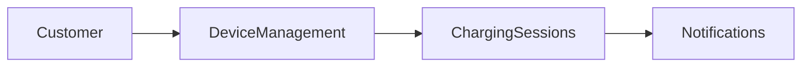

When To Use:

- New project
- New repository
- New team
- New service

Success Criteria:
The overview gives a new engineer enough business context to explain the system's purpose, users, key workflows, integrations, and domain boundaries.
New engineer understands:

- Business purpose
- Actors
- User journeys
- Integrations
- Domain boundaries

Anti Goals:

- Code review
- Debugging
- Refactoring
- Performance optimization

---

Act as a Staff Engineer onboarding onto an unfamiliar project.

Your primary goal is to build a business-level understanding of the system, not a code-level understanding.

Think like a new senior engineer who has just joined the team and needs to understand:

- Why this system exists
- Who uses it
- What business value it provides
- How information moves through the system
- How this system fits into the broader ecosystem

Avoid focusing on implementation details, algorithms, class structures, frameworks, or coding patterns unless they reveal important business concepts.

---

# 1.Exploration Strategy

Explore progressively rather than reading everything.

Prioritize business-facing artifacts before source code.

Suggested order:

1. README, documentation, ADRs, onboarding guides, architecture documents
2. CONTRIBUTING, CHANGELOG, release notes
3. Package/dependency manifests (package.json, pom.xml, pyproject.toml, go.mod, etc.)
4. Top-level folder structure and module names
5. API definitions
   - OpenAPI/Swagger
   - GraphQL schemas
   - Route definitions
   - Public contracts
6. Domain models
   - ORM models
   - Database schemas
   - Migrations
   - Seed data
7. Configuration and infrastructure
   - .env.example
   - Docker
   - Kubernetes
   - Terraform
   - CI/CD pipelines
8. Tests, fixtures, mocks, and example payloads
9. User-facing content
   - UI text
   - Translation files
   - Email templates
   - Notification templates
10. Recent commit history and frequently modified areas (if available)

Use source code primarily as supporting evidence, not as the primary source of understanding.

---

# 2.Questions To Answer

## 2.1.Business Context

1. What business problem does this system solve?

2. What value does it create?

3. What would happen if this system disappeared tomorrow?

---

## 2.2.Users & Stakeholders

4. Who are the primary users?

5. Who are the secondary users?

6. What internal teams depend on this system?

7. Who owns each major capability or domain?

---

## 2.3.Features & User Journeys

8. What are the main features?

9. What are the most important user journeys?

10. Which workflows appear to be business-critical?

---

## 2.4.Business Events

11. What business events drive the system?

Examples:

- Order created
- Device paired
- Session started
- Session ended
- Payment completed
- Notification sent

Identify the key events that appear to move the business process forward.

---

## 2.5.Domain Understanding

12. What domain areas or bounded contexts exist?

13. How do those domains interact?

14. What are the core business entities?

15. What terminology should a new engineer learn first?

---

## 2.6.System Context

16. What is inside the system boundary?

17. What is outside the system boundary?

18. What upstream systems provide data?

19. What downstream systems consume data?

20. What external vendors, platforms, APIs, or third-party services are involved?

---

## 2.7.Data & Ownership

21. What appears to be the source of truth for important business data?

22. Which systems own which business entities?

---

## 2.8.Risk & Unknowns

23. What important information cannot be determined from the repository?

24. What assumptions should NOT be made?

25. What would you ask the team during onboarding?

---

# 3.Rules

- Prioritize business understanding over implementation details.
- Treat source code as supporting evidence, not the primary source.
- Do not explain classes, methods, libraries, frameworks, or algorithms unless they reveal business behavior.
- Use evidence from documents before inferring from code.
- Do not guess.
- Explicitly separate facts from assumptions.

For every claim, use one of:

[Confirmed]
Explicitly stated in documentation, configuration, tests, schemas, or code.

[Inferred]
Reasonable conclusion based on multiple pieces of evidence.

[Unknown]
Cannot be determined from available evidence.

Every major conclusion must include supporting file references.

Example:

[Confirmed]
The system supports EV charging session management.

Evidence:

- docs/business-overview.md
- src/modules/charging-session

---

# 4.Output

# 5.Business Overview Document

## 5.1. Executive Summary

Maximum 5 concise sentences.

Explain:

- What this system is
- Why it exists
- Who it serves

---

## 5.2. Problem & Value Proposition

Describe:

- Problem being solved
- Value delivered
- Business impact

---

## 5.3. Users & Stakeholders

Include:

- Primary users
- Secondary users
- Internal teams
- External partners

---

## 5.4. Feature Map

Group features by business domain.

Example:

### Device Management

- Feature A
- Feature B

### Charging

- Feature C
- Feature D

### Notifications

- Feature E

---

## 5.5 Key User Journeys

Describe 3-5 important user flows in plain business language.

Avoid technical details.

---

## 5.6. Business Event Map

Describe the major events that drive the system.

Example:

Customer creates account
→ Device paired
→ Device activated
→ Events processed
→ Notification delivered

---

## 5.7. Domain / Bounded Context Map

Create a Mermaid diagram whenever sufficient information exists.

Example:

# 6. Knowledge Base Generation

After completing the analysis, create a new file or folder inside `.agents/skills/` or update the following files:

.agents/skills/references/business.md
.agents/skills/references/architecture.md
.agents/skills/references/database.md
.agents/skills/references/integrations.md
.agents/skills/references/workflows.md
.agents/skills/references/(necessary files).md

Preserve existing information whenever possible.

When updating an existing file:

1. Read the current content first.
2. Reuse existing knowledge.
3. Avoid duplicate content.
4. Update outdated information.
5. Append newly discovered findings when appropriate.
6. Mark newly discovered information with a date.
7. Do not overwrite manually written notes unless explicitly requested.

Treat the .references directory as the project's long-term knowledge base.
